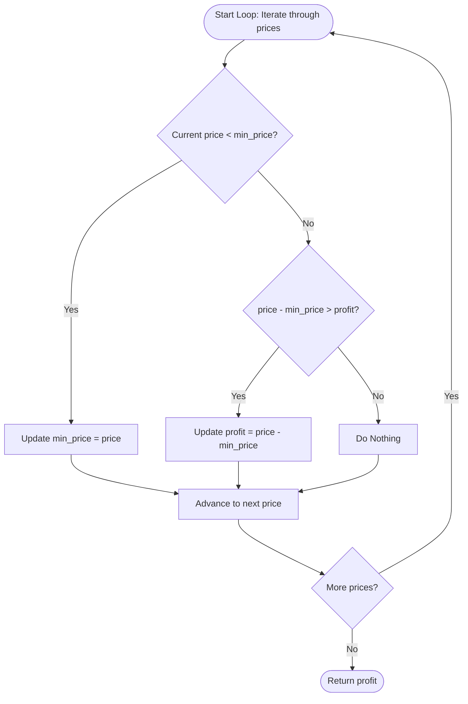

<h2><a href="https://leetcode.com/problems/best-time-to-buy-and-sell-stock">121. Best Time to Buy and Sell Stock</a></h2>

<p>You are given an array <code>prices</code> where <code>prices[i]</code> is the price of a given stock on the <code>i<sup>th</sup></code> day.</p>

<p>You want to maximize your profit by choosing a <strong>single day</strong> to buy one stock and choosing a <strong>different day in the future</strong> to sell that stock.</p>

<p>Return <em>the maximum profit you can achieve from this transaction</em>. If you cannot achieve any profit, return <code>0</code>.</p>

<p>&nbsp;</p>
<p><strong class="example">Example 1:</strong></p>

<pre><strong>Input:</strong> prices = [7,1,5,3,6,4]
<strong>Output:</strong> 5
<strong>Explanation:</strong> Buy on day 2 (price = 1) and sell on day 5 (price = 6), profit = 6-1 = 5.
Note that buying on day 2 and selling on day 1 is not allowed because you must buy before you sell.
</pre>

<p><strong class="example">Example 2:</strong></p>

<pre><strong>Input:</strong> prices = [7,6,4,3,1]
<strong>Output:</strong> 0
<strong>Explanation:</strong> In this case, no transactions are done and the max profit = 0.
</pre>

<p>&nbsp;</p>
<p><strong>Constraints:</strong></p>

<ul>
	<li><code>1 &lt;= prices.length &lt;= 10<sup>5</sup></code></li>
	<li><code>0 &lt;= prices[i] &lt;= 10<sup>4</sup></code></li>
</ul>


---

# 🛍️ Best-Time-to-Buy-and-Sell-Stock | Explained

## Approach 1: Single-Pass Greedy (Tracking Minimum Price)
### Intuition
Imagine you are walking through an open-air marketplace over the course of several days looking to buy and sell a single rare collectible. You cannot see the future, but each day you learn that day's price. 

To maximize your gain, you want to buy on the day the item was at its absolute cheapest before selling it. As you move forward day by day, you ask yourself two simple questions:
1. *"Is today's price cheaper than any price I've seen before?"* If yes, update your mental benchmark—this is your new ideal buying opportunity going forward.
2. *"If I bought at my lowest recorded price in the past and sold today, would that give me a bigger profit than any deal I could have made so far?"* If yes, lock in this new personal best.

Because you only consider selling at the current price using a purchase price from a prior (or current) day, you naturally preserve the constraint that buying must precede selling without needing to compare every single pair of days.

### Algorithm Visualized


### Approach
1. **Initialize State:** 
   - Set `profit = 0` to account for the possibility of continuous price drops (where no profitable trade is possible, yielding `0`).
   - Set `min_price = prices[0]` as our initial baseline, assuming the earliest buying opportunity is Day 0.
2. **Scan Once Through the Array:** 
   - Iterate through every element `price` in `prices`.
3. **Update Local Minimum:** 
   - If the current `price` is strictly less than `min_price`, update `min_price = price`. An update here means selling today yields $0$ profit relative to the new minimum, so we skip checking profit for this step (handled via `elif`).
4. **Update Global Maximum Profit:** 
   - If `price >= min_price`, evaluate the margin: `price - min_price`. If this margin exceeds our running `profit`, update `profit`.
5. **Return Result:** 
   - Return the recorded `profit` after traversing the list.

### Detailed Code Analysis
- **Lines 3–4:**
  ```python
  profit = 0 
  min_price = prices[0]
  ```
  - Initializes `profit` to `0`. If prices decrease monotonically (e.g., `[7, 6, 4, 3, 1]`), we never make a transaction, and returning `0` is the correct result according to the problem specification.
  - Sets `min_price` to `prices[0]`. This establishes the first element as the initial candidate for the optimal buying day. *(Note: This assumes `prices` contains at least 1 element, consistent with LeetCode's constraints of $1 \le \text{prices.length} \le 10^5$.)*

- **Line 5:**
  ```python
  for price in prices:
  ```
  - Executes a single linear scan ($O(N)$) through the list. On the very first iteration, `price == prices[0] == min_price`.

- **Lines 6–7:**
  ```python
  if price < min_price:
      min_price = price
  ```
  - Checks if the current day presents a better buying opportunity than all preceding days.
  - When true, it greedily lowers `min_price`. Since `price - min_price` would be $0$ here, selling on this day against the newly discovered minimum cannot yield a positive profit.

- **Lines 8–9:**
  ```python
  elif price - min_price > profit:
      profit = price - min_price
  ```
  - The `elif` ensures that profit evaluation occurs only when the price did not reset `min_price`. 
  - Computes the delta `price - min_price` (selling today after buying at the historical low). If this exceeds the previous highest recorded profit, `profit` is updated.

- **Line 11:**
  ```python
  return profit
  ```
  - Returns the maximum profit observed across the entire time horizon.

### Code
```python
class Solution:
    def maxProfit(self, prices: list[int]) -> int:
        profit = 0 
        min_price = prices[0]
        for price in prices:
            if price < min_price:
                min_price = price
            elif price - min_price > profit:
                profit = price - min_price

        return profit 
```

### Complexity
- **Time:** $O(N)$, where $N$ is the number of days (length of `prices`). The list is traversed exactly once, performing constant-time $O(1)$ comparisons and arithmetic operations at each iteration.
- **Space:** $O(1)$ auxiliary memory. The algorithm tracks state using only two scalar variables (`profit` and `min_price`), requiring no additional dynamic data structures.

## 🕵️‍♂️ Follow-up Questions (Optional)

1. **How does this logic change if you are allowed to complete as many transactions as you like (Best Time to Buy and Sell Stock II)?**
   - In that scenario, you no longer need to find a single global valley and peak. Instead, you capture every upward price movement (every local increase where `prices[i] > prices[i - 1]`) by accumulating `prices[i] - prices[i - 1]` whenever it is positive.

2. **What if the constraints allowed an empty array `prices = []`?**
   - Accessing `prices[0]` on line 4 would raise an `IndexError`. To make the implementation robust against empty inputs, you would add a guard condition `if not prices: return 0` or initialize `min_price = float('inf')`.