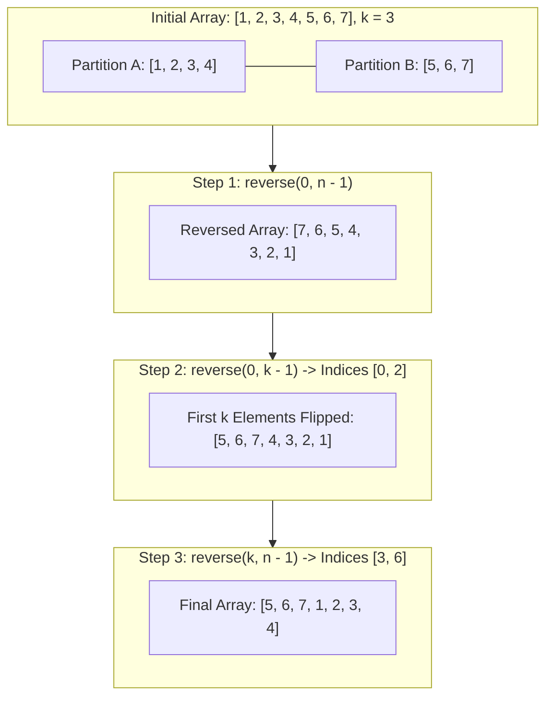

<h2><a href="https://leetcode.com/problems/rotate-array">189. Rotate Array</a></h2>

<p>Given an integer array <code>nums</code>, rotate the array to the right by <code>k</code> steps, where <code>k</code> is non-negative.</p>

<p>&nbsp;</p>
<p><strong class="example">Example 1:</strong></p>

<pre><strong>Input:</strong> nums = [1,2,3,4,5,6,7], k = 3
<strong>Output:</strong> [5,6,7,1,2,3,4]
<strong>Explanation:</strong>
rotate 1 steps to the right: [7,1,2,3,4,5,6]
rotate 2 steps to the right: [6,7,1,2,3,4,5]
rotate 3 steps to the right: [5,6,7,1,2,3,4]
</pre>

<p><strong class="example">Example 2:</strong></p>

<pre><strong>Input:</strong> nums = [-1,-100,3,99], k = 2
<strong>Output:</strong> [3,99,-1,-100]
<strong>Explanation:</strong> 
rotate 1 steps to the right: [99,-1,-100,3]
rotate 2 steps to the right: [3,99,-1,-100]
</pre>

<p>&nbsp;</p>
<p><strong>Constraints:</strong></p>

<ul>
	<li><code>1 &lt;= nums.length &lt;= 10<sup>5</sup></code></li>
	<li><code>-2<sup>31</sup> &lt;= nums[i] &lt;= 2<sup>31</sup> - 1</code></li>
	<li><code>0 &lt;= k &lt;= 10<sup>5</sup></code></li>
</ul>

<p>&nbsp;</p>
<p><strong>Follow up:</strong></p>

<ul>
	<li>Try to come up with as many solutions as you can. There are at least <strong>three</strong> different ways to solve this problem.</li>
	<li>Could you do it in-place with <code>O(1)</code> extra space?</li>
</ul>


---

# 🛍️ Rotate-Array | Explained

## Approach 1: Three-Step Array Reversal Algorithm (In-Place)

### Intuition
Think of the array as two separate train cars linked together: Car $A$ (the first $n - k$ elements) and Car $B$ (the last $k$ elements). To rotate the array to the right by $k$ positions, our goal is to swap their order from $[A, B]$ to $[B, A]$ without disturbing the internal order of the elements inside each car.

A classic real-world analogy is reversing the words in a sentence. Consider the phrase `"BLUE SKY"` which has the structure $[A, B]$. If you reverse every single character in the entire sentence, you get `"YKS EULB"` ($[B^R, A^R]$). Both words are now in the correct target positions, but their internal letters are backwards. If you then reverse the letters of the first word (`"YKS"` $\rightarrow$ `"SKY"`) and reverse the letters of the second word (`"EULB"` $\rightarrow$ `"BLUE"`), you end up with `"SKY BLUE"` ($[B, A]$).

By applying this exact property to an array—reversing the whole array, and then reversing the two partitions individually—we achieve a right rotation strictly in-place.

### Algorithm Visualized


### Approach
1. **Normalize $k$**: Because rotating an array of size $n$ by $n$ times yields the identical array, any rotation where $k \ge n$ can be simplified using the modulo operator: `k = k % n`.
2. **Reverse the entire array (`0` to `n - 1`)**: This moves the elements from the back of the array to the front, and vice versa. However, their relative order is currently mirrored.
3. **Reverse the first $k$ elements (`0` to `k - 1`)**: This restores the correct original relative ordering of the elements that were shifted from the end to the front.
4. **Reverse the remaining $n - k$ elements (`k` to `n - 1`)**: This restores the correct original relative ordering of the elements that were originally at the beginning of the array.

### Detailed Code Analysis

```python
n = len(nums)
k %= n 
```
- Line 6 queries `len(nums)` to store the size of the array $n$.
- Line 7 applies `k %= n`. This handles the edge case where $k$ is greater than or equal to $n$. For example, if $n = 5$ and $k = 12$, rotating 12 times is equivalent to rotating $12 \pmod 5 = 2$ times. If $k$ is an exact multiple of $n$, $k$ becomes $0$, leaving the array unchanged after the operations.

```python
def reverse(left, right):
    while left < right:
        nums[left], nums[right] = nums[right], nums[left]
        right -= 1
        left += 1
```
- Lines 9–13 define an inline helper function `reverse(left, right)` which implements a classical two-pointer swap:
  - `left` starts at the leftmost boundary, and `right` starts at the rightmost boundary.
  - In each iteration of the `while left < right` loop, `nums[left]` and `nums[right]` are swapped simultaneously via Python tuple unpacking (`nums[left], nums[right] = nums[right], nums[left]`).
  - `left` moves rightward (`left += 1`) and `right` moves leftward (`right -= 1`) until they meet or cross in the middle.
  - This reverses the designated subarray directly in-place with zero external allocations.

```python
reverse(0, n - 1)
reverse(0, k - 1)
reverse(k, n - 1)
```
- Line 15 calls `reverse(0, n - 1)`: Reverses the entire array across the full index range $[0, n - 1]$. The elements that must end up at indices $[0, k - 1]$ are now at the front, but in backwards order. The elements that must end up at indices $[k, n - 1]$ are now at the back, also in backwards order.
- Line 16 calls `reverse(0, k - 1)`: Reverses the sub-segment from index $0$ to $k - 1$. This rectifies the first $k$ elements into their proper ascending relative order.
- Line 17 calls `reverse(k, n - 1)`: Reverses the remaining sub-segment from index $k$ to $n - 1$. This restores the remaining $n - k$ elements to their proper relative order.

### Code
```python
class Solution:
    def rotate(self, nums: list[int], k: int) -> None:
        """
        Do not return anything, modify nums in-place instead.
        """
        n = len(nums)
        k %= n 

        def reverse(left, right):
            while left < right:
                nums[left], nums[right] = nums[right], nums[left]
                right -= 1
                left += 1
      
        reverse(0, n - 1)
        reverse(0, k - 1)
        reverse(k, n - 1)
```

### Complexity
- **Time:** $O(n)$
  - Reversing the entire array takes $\lfloor \frac{n}{2} \rfloor$ swaps.
  - Reversing the first $k$ elements takes $\lfloor \frac{k}{2} \rfloor$ swaps.
  - Reversing the remaining $n - k$ elements takes $\lfloor \frac{n - k}{2} \rfloor$ swaps.
  - Total swaps = $\lfloor \frac{n}{2} \rfloor + \lfloor \frac{k}{2} \rfloor + \lfloor \frac{n - k}{2} \rfloor \approx n$ total element accesses/swaps. This is strictly linear time, $O(n)$.
- **Space:** $O(1)$
  - The algorithm operates directly on the input list `nums`. The pointers `left`, `right`, `n`, and `k` consume constant auxiliary space $O(1)$. No additional data structures or stack frames are created beyond standard function calls.

---

## 🕵️‍♂️ Follow-up Questions (Optional)

1. **How can this problem be solved in $O(n)$ time and $O(1)$ space using Cyclic Replacements (the Juggling Algorithm)?**
   - Instead of reversing, you can view the array as a set of independent permutation cycles. By tracking the count of elements placed and moving elements directly to their target indices `(current_index + k) % n` using a temporary variable, you complete the rotation in exactly $n$ moves across $\gcd(n, k)$ distinct cycles.

2. **What if the rotation is to the left by $k$ instead of to the right?**
   - For a left rotation by $k$, you can either:
     - Convert it to a right rotation by calculating `k_right = n - (k % n)`.
     - Or reverse the first $k$ elements first `reverse(0, k - 1)`, then the remaining elements `reverse(k, n - 1)`, and finally reverse the entire array `reverse(0, n - 1)`.