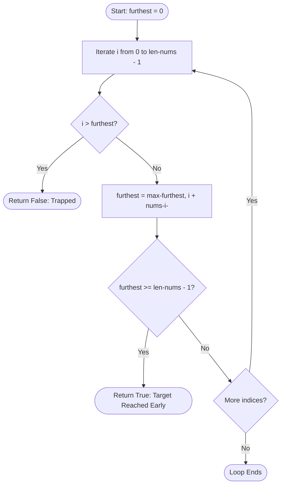

<h2><a href="https://leetcode.com/problems/jump-game">55. Jump Game</a></h2>

You are given an integer array <code>nums</code>. You are initially positioned at the array's <strong>first index</strong>, and each element in the array represents your maximum jump length at that position.

Return <code>true</code><em> if you can reach the last index, or </em><code>false</code><em> otherwise</em>.

&nbsp;

<strong class="example">Example 1:</strong>

<pre><strong>Input:</strong> nums = [2,3,1,1,4]
<strong>Output:</strong> true
<strong>Explanation:</strong> Jump 1 step from index 0 to 1, then 3 steps to the last index.
</pre>

<strong class="example">Example 2:</strong>

<pre><strong>Input:</strong> nums = [3,2,1,0,4]
<strong>Output:</strong> false
<strong>Explanation:</strong> You will always arrive at index 3 no matter what. Its maximum jump length is 0, which makes it impossible to reach the last index.
</pre>

&nbsp;

<strong>Constraints:</strong>

<ul>
	<li><code>1 &lt;= nums.length &lt;= 104</code></li>
	<li><code>0 &lt;= nums[i] &lt;= 105</code></li>
</ul>

---

# 🛍️ Jump-Game | Explained

## Approach 1: Greedy Forward Reach with Early Exit
### Intuition
Imagine you are walking down a path of stepping stones at night, carrying a flashlight with an adjustable beam. Each stepping stone has a battery (`nums[i]`) that can extend your flashlight's beam forward by `nums[i]` stones. 

Your goal is to reach the last stone. As you step from one stone to the next:
1. If you ever reach a stone that falls completely beyond your current flashlight beam (`i > furthest`), you are stuck in total darkness and cannot move forward.
2. Otherwise, you shine your light ahead from your new vantage point. If this new vantage point pushes your beam farther than before (`i + nums[i]`), you update your maximum reach (`furthest`).
3. If at any point your beam illuminates the final stone or beyond (`furthest >= len(nums) - 1`), you immediately know the finish line is reachable without needing to inspect the remaining stones.

This greedy strategy works because reachable indices form a contiguous range: if you can reach index $K$, you can automatically reach every index from $0$ to $K$.

### Algorithm Visualized

### Approach
1. **Initialize State Tracker:** Maintain a variable `furthest = 0` representing the furthest index reachable so far.
2. **Iterate Through Indices:** Traverse through every index `i` from `0` to `len(nums) - 1`.
3. **Check Reachability:** At each step, test if the current index `i` exceeds `furthest`. If it does, you have hit an unreachable gap (e.g., stranded by prior zeros). Return `False`.
4. **Greedy Extension:** Update `furthest = max(furthest, i + nums[i])`. This greedily extends the maximum boundary reachable from all explored locations.
5. **Early Exit Optimization:** After updating,