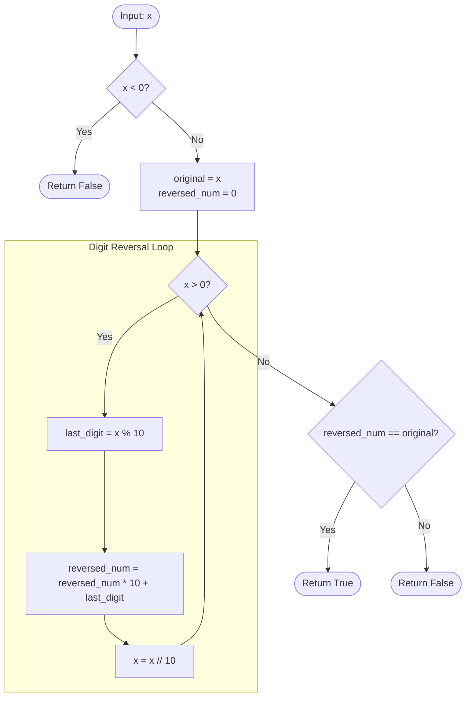

<h2><a href="https://leetcode.com/problems/palindrome-number">9. Palindrome Number</a></h2>

<p>Given an integer <code>x</code>, return <code>true</code> if <code>x</code> is a <span data-keyword="palindrome-integer" class=" cursor-pointer relative text-dark-blue-s text-sm"><button type="button" aria-haspopup="dialog" aria-expanded="false" aria-controls="radix-_r_t_" data-state="closed" class=""><strong>palindrome</strong></button></span>, and <code>false</code> otherwise.</p>

<p>&nbsp;</p>
<p><strong class="example">Example 1:</strong></p>

<pre><strong>Input:</strong> x = 121
<strong>Output:</strong> true
<strong>Explanation:</strong> 121 reads as 121 from left to right and from right to left.
</pre>

<p><strong class="example">Example 2:</strong></p>

<pre><strong>Input:</strong> x = -121
<strong>Output:</strong> false
<strong>Explanation:</strong> From left to right, it reads -121. From right to left, it becomes 121-. Therefore it is not a palindrome.
</pre>

<p><strong class="example">Example 3:</strong></p>

<pre><strong>Input:</strong> x = 10
<strong>Output:</strong> false
<strong>Explanation:</strong> Reads 01 from right to left. Therefore it is not a palindrome.
</pre>

<p>&nbsp;</p>
<p><strong>Constraints:</strong></p>

<ul>
	<li><code>-2<sup>31</sup>&nbsp;&lt;= x &lt;= 2<sup>31</sup>&nbsp;- 1</code></li>
</ul>

<p>&nbsp;</p>
<strong>Follow up:</strong> Could you solve it without converting the integer to a string?

---

# 🛍️ Palindrome-Number | Explained

## Approach 1: Full Mathematical Integer Reversal
### Intuition
Imagine you have a stack of numbered blocks arranged left-to-right (e.g., `1-2-1`). If you pick blocks one by one from the right edge and place them down into a new row from left to right, you end up constructing the exact mirror image of the original layout. 

In mathematics, you can peel off the rightmost digit of any base-10 number using the modulo operator (`x % 10`). You can then append this digit to a new number by multiplying the existing reversed total by `10` and adding the extracted digit. If the reconstructed number is identical to the original number you started with, the sequence is symmetric and therefore a palindrome. Any negative number fails automatically because the negative sign (`-`) only sits at the front and can never mirror itself at the back.

### Algorithm Visualized



### Approach
1. **Filter Negative Values:** Negative numbers (e.g., `-121`) cannot be palindromes due to the leading minus sign. Return `False` immediately if `x < 0`.
2. **Preserve State:** Assign `x` to a temporary variable `original` because the iterative digit-stripping process will mutate `x` down to `0`.
3. **Initialize the Reversal Accumulator:** Set `reversed_num = 0`.
4. **Extract and Rebuild:** While `x > 0`:
   - Extract the rightmost digit via `x % 10`.
   - Shift the accumulated `reversed_num` left by one decimal place (`reversed_num * 10`) and add the extracted digit.
   - Truncate the rightmost digit from `x` using integer floor division (`x //= 10`).
5. **Evaluate Equality:** Check whether `reversed_num == original`. If they are equal, return `True`; otherwise, return `False`.

### Detailed Code Analysis

```python
class Solution:
    def isPalindrome(self, x: int) -> bool:
        # Negative numbers can never be palindromes (the '-' sign breaks symmetry)
        if x < 0:
            return False
```
- **Lines 4–5:** Acts as an immediate guard clause. Any negative input (e.g., `-10`, `-121`) reads as `121-` when reversed, which is neither a valid integer representation nor equivalent to the original. This check executes in $O(1)$ time.

```python
        original = x       # keep a copy, since the loop consumes x
        reversed_num = 0
```
- **Lines 7–8:** In Python, integers are immutable primitives. `original = x` binds the value of `x` to `original`. We must preserve the starting value because our digit extraction loop continuously reduces `x` until it hits `0`. `reversed_num` is initialized to hold the running total of the mirrored integer.

```python
        while x > 0:
            last_digit = x % 10                          # peel off the last digit
            reversed_num = reversed_num * 10 + last_digit  # append it to the reversed number
            x //= 10                                     # drop the last digit (integer division)
```
- **Lines 10–13:** The core mathematical loop:
  - `last_digit = x % 10`: The modulo operator extracts the remainder of division by 10, which corresponds precisely to the least significant digit (e.g., `123 % 10 = 3`).
  - `reversed_num = reversed_num * 10 + last_digit`: Multiplying `reversed_num` by 10 shifts all existing digits one rank higher (tens become hundreds, etc.), creating an empty units place to add `last_digit`.
  - `x //= 10`: Integer division truncates the number, discarding the least significant digit (e.g., `123 // 10 = 12`).
  - The loop terminates when `x` reaches `0`, meaning all digits have been processed.

```python
        # A palindrome equals its own reversal
        return reversed_num == original
```
- **Line 16:** Performs a boolean comparison. If `reversed_num` matches `original`, every digit pair mirrored cleanly around the center of the number.

### Code
```python
class Solution:
    def isPalindrome(self, x: int) -> bool:
        if x < 0:
            return False

        original = x
        reversed_num = 0

        while x > 0:
            last_digit = x % 10
            reversed_num = reversed_num * 10 + last_digit
            x //= 10

        return reversed_num == original
```

### Complexity
- **Time:** $O(\log_{10}(n))$ where $n$ is the input integer `x`. In each pass of the `while` loop, the algorithm divides $x$ by $10$. The total number of iterations equals the number of digits in $x$, which is $\lfloor\log_{10}(x)\rfloor + 1$. For a 32-bit signed integer, $x \le 2^{31} - 1 \approx 2.14 \times 10^9$, requiring at most 10 iterations.
- **Space:** $O(1)$ auxiliary space. The algorithm only allocates memory for a few primitive integer variables (`original`, `reversed_num`, and `last_digit`), requiring constant extra space regardless of the magnitude of the input.

---

## 🕵️‍♂️ Follow-up Questions

1. **How would you prevent potential 32-bit integer overflow in statically typed languages like C++ or Java?**
   - *Answer:* In Python, integers have arbitrary precision, preventing overflow. However, in C++ or Java, reversing a large 32-bit number like `2147483647` causes `reversed_num` to exceed the maximum 32-bit signed integer limit (`2147483647`), causing an overflow. To resolve this, you can reverse only the **half** of the number: iterate until `x <= reversed_num`. At that point, compare `x == reversed_num` (for even digit lengths) or `x == reversed_num / 10` (for odd digit lengths).

2. **Can this problem be solved without converting to a string or doing arithmetic reversal?**
   - *Answer:* Yes, by comparing the most significant digit (MSD) and least significant digit (LSD) simultaneously. You can compute the highest divisor power of 10 (e.g., `1000` for `1221`), extract both ends (`x / divisor` and `x % 10`), check equality, and then strip both ends (`x = (x % divisor) / 10`, `divisor /= 100`). This maintains $O(1)$ space without creating a full reversed copy.